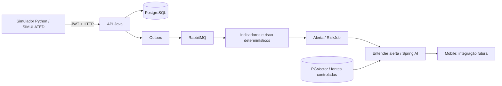

# Agro Conecta — IoT e IA

Apoio ao pequeno produtor que precisa acompanhar o solo e decidir quando verificar o cultivo. Sensores simulados alimentam indicadores determinísticos; uma orientação contextual com fontes ajuda a interpretar o alerta. O projeto busca reduzir desperdício de água e apoiar agricultura sustentável (ODS 2), usando infraestrutura digital acessível (ODS 9). Benefícios são objetivos do protótipo, não impacto de campo já medido.

## Responsabilidades e arquitetura

Este repositório contém Python para simulação, integração e avaliação. A [API Java](https://github.com/deryksouza2006/GS-FINAL) mantém autenticação, propriedade dos dados, persistência, indicadores, RabbitMQ, alertas, Spring AI e RAG. Não há chatbot Python, NDVI nem cópia da API. O Mobile é consumidor futuro; não está implementado neste pacote.



## Instalação e execução

Python 3.12+; validado localmente em 3.13.2. Runtime sem dependências externas.

```sh
python -m venv .venv
# Windows: .venv/Scripts/activate ; Linux/macOS: source .venv/bin/activate
python -m pip install -e '.[dev]'
python -m agro_conecta_iot simulate --scenario normal --dry-run --reference 2026-11-11T18:00:00Z
python -m agro_conecta_iot evaluate
python -m unittest discover -s tests -v
ruff check .
python scripts/check_repository.py
```

Execute a partir da raiz. No Windows com alias da Store, use `py -3` ou o executável da venv. Seed padrão 2026; fixar também `--reference` garante timestamps idênticos. Referência passada serve para dry-run; não use leituras antigas esperando risco atual.

Configure variáveis de ambiente conforme [.env.example](.env.example). O Python não carrega .env automaticamente. Em PowerShell: `$env:JAVA_API_BASE_URL='http://localhost:8080'`. Credenciais devem ser definidas localmente, jamais coladas no código. Use token OU usuário/senha. IDs omitidos assumem 1 apenas para dry-run; configure-os explicitamente para integração.

Para envio real, iniciar primeiro as dependências e o Java conforme [integração](docs/integracao-java.md), com `APP_DEMO_ENABLED=true`. Cadastrar produtor, propriedade, cultivo, perfil DEMO e sensor WEATHER_STATION. Depois:

```sh
python -m agro_conecta_iot simulate --scenario normal
python -m agro_conecta_iot simulate --scenario attention
python -m agro_conecta_iot simulate --scenario critical
python -m agro_conecta_iot simulate --scenario insufficient-data
python -m agro_conecta_iot simulate --scenario sensor-stale
python -m agro_conecta_iot simulate --scenario possible-sensor-fault
```

**Use cultivo e sensor exclusivos por cenário**: leituras anteriores recentes podem preencher dados ausentes ou prevalecer sobre leituras antigas. O script opt-in `python scripts/verify_java.py` cria recursos isolados e verifica os seis cenários, JWT, isolamento, entradas inválidas e fallback. Use somente banco de desenvolvimento com IA desabilitada.

Docker: `docker compose run --rm simulator` executa dry-run. Para envio, sobrescreva o comando e configure variáveis. Não são duplicados os serviços PostgreSQL/RabbitMQ do Java. O hostname `host.docker.internal` aponta para o Java no host.

## Sensores e indicadores

Temperatura °C, umidade do ar/solo %, bateria %, timestamps UTC e chuva opcional com intervalo. Perfil DEMO: capacidade de campo 32%, ponto de murcha 12%. Esses números são dados de teste e não recomendações agronômicas. Java calcula VPD, disponibilidade hídrica, tendência, chuva e saúde. Ver [fórmulas e limites](docs/indicadores-iot.md).

## IA e RAG

Spring AI usa Gemini 2.5 Flash por padrão; embeddings `gemini-embedding-001` (768 dimensões), PGVector e quatro resumos institucionais versionados. RAG foi escolhido para limitar a orientação a referências atribuídas sem treinar outro modelo. Fontes vêm da recuperação, não do texto gerado. Erros e contexto insuficiente geram fallback explícito sem fonte inventada. Ver [RAG](docs/rag.md) e [manifesto](knowledge-base/sources.json).

`evaluate` usa oito fixtures locais e não consome serviço pago. `evaluate --live --bindings reports/bindings.json` usa jobs reais previamente preparados; pode consumir provedor pago no Java. Sem binding, o caso fica não executado e a saída não passa. [Avaliação](docs/avaliacao-ia.md) distingue contrato, integração real local e modelo real. Não atribuímos precisão ao Gemini com base em mocks.

## Segurança e limitações

JWT, isolamento no Java, rota de simulação desabilitada por padrão, timeout HTTP e retries limitados somente para GET. Erros não exibem token, corpo remoto ou senha. Leituras são sempre SIMULATED. Regras e saúde são heurísticas demonstrativas; não acionam irrigação, não diagnosticam doença/praga e não prescrevem defensivos. [Limitações](docs/seguranca-e-limitacoes.md).

## Entrega FIAP

[Checklist da rubrica](docs/checklist-rubrica.md), [roteiro de três minutos](docs/roteiro-demonstracao.md), [evidências](docs/evidencias/) e [identificação](entrega/identificacao.txt).

- Integrantes, RM e turma: **PREENCHER** em identificação antes de entregar.
- Vídeo: **PREENCHER após gravação**.
- IoT/IA: https://github.com/LucasViana130/agro-conecta-iot-ai
- Java: https://github.com/deryksouza2006/GS-FINAL

Uso de IA: Codex auxiliou inspeção, implementação, testes e documentação. O grupo deve revisar, compreender e defender o trabalho. Gemini é o modelo da funcionalidade em runtime; sua validação real está separada dos testes automatizados sem provedor. Nenhuma informação pessoal de integrantes foi inventada.
