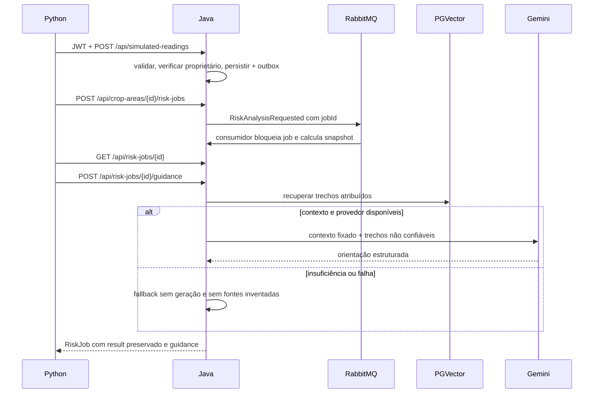

# Arquitetura e limites

Python nunca recalcula risco para decidir alertas. O processo Java controla PostgreSQL, outbox com confirmação, retries/DLQ, risco e autorização. Leituras e perfil são fixados no job. Atividades dos últimos 30 dias são consultadas no momento da orientação, limitadas a 10, com corte temporal na criação do job. Alterações retroativas de atividades podem mudar o contexto; não é snapshot integral de atividades.

Mobile, .NET e hardware físico ficam fora deste repositório. A UI futura deve identificar SIMULATED, distinguir fallback, mostrar fontes e conservar o resultado determinístico mesmo em falhas.
